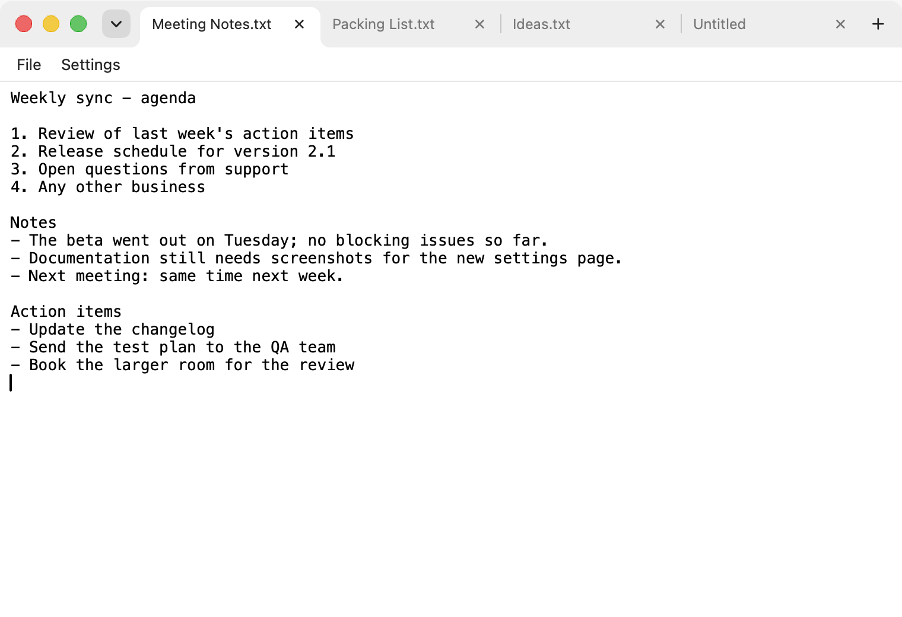
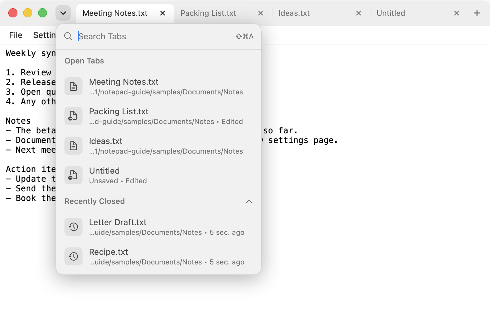
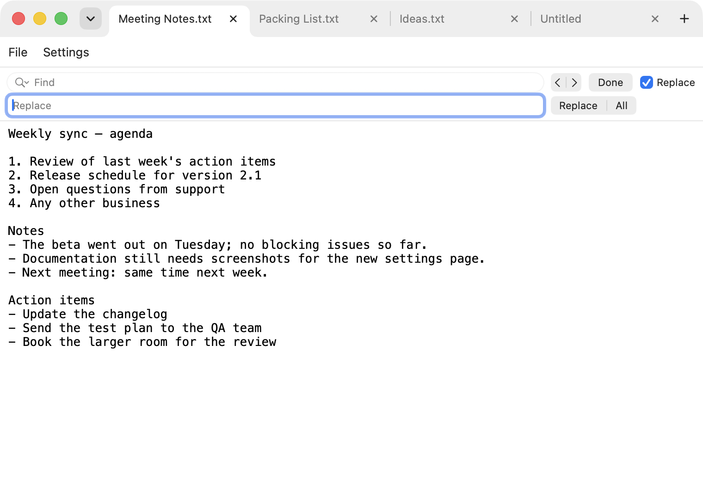
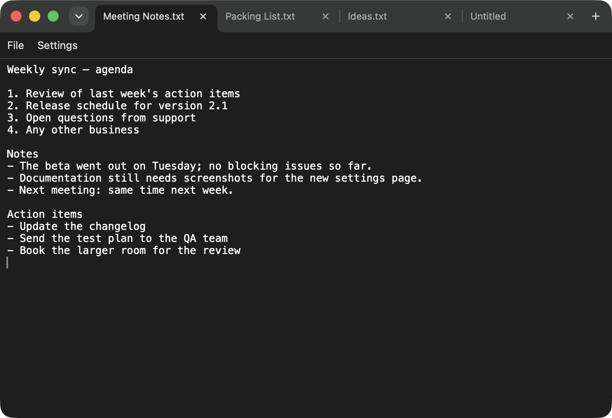
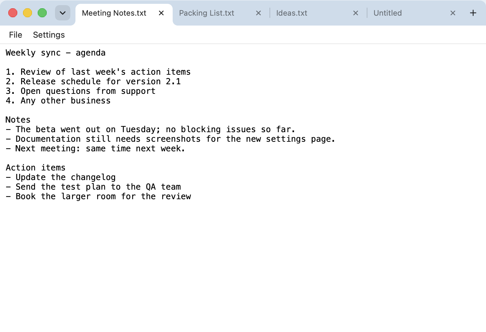
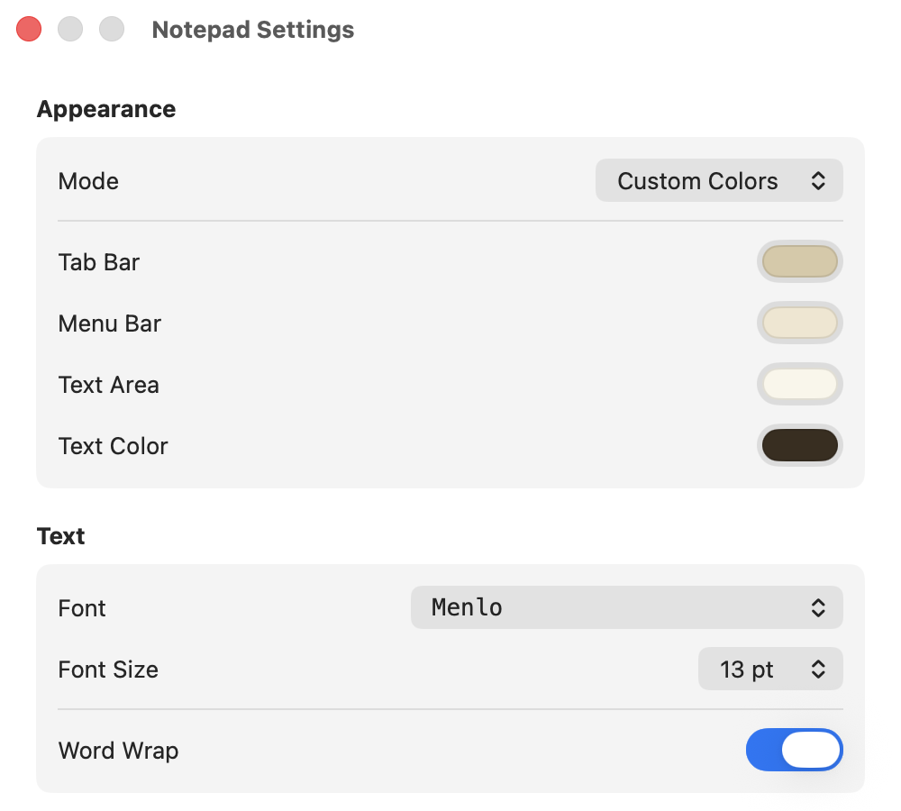
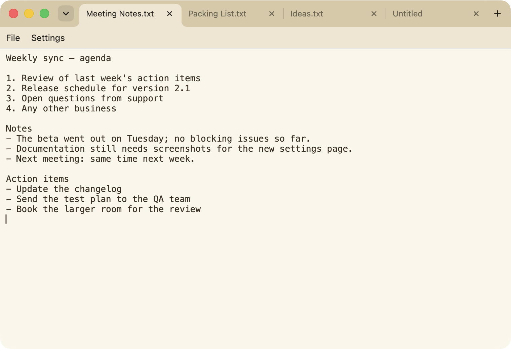
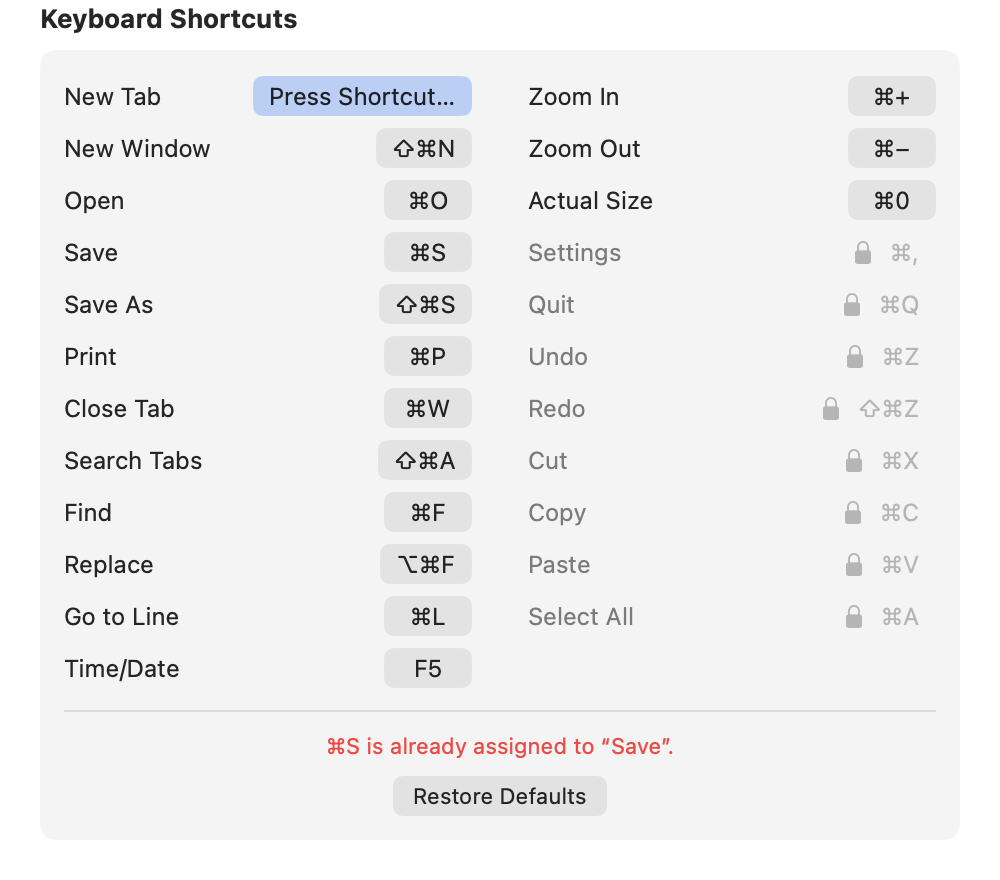

# Notepad for Mac

Notepad is a small plain-text editor for macOS, modelled on the Windows Notepad: one text area, a "File" menu, no formatting. Unlike the original it has tabs in the title bar that work like browser tabs, can spread those tabs over several windows, and lets you change the colors, the font and the keyboard shortcuts. It is written in Swift (SwiftUI and AppKit) and has no dependencies.



## Contents

- [Features](#features)
- [Download](#download)
- [Requirements](#requirements)
- [Building from source](#building-from-source)
- [Using Notepad](#using-notepad)
  - [The window](#the-window)
  - [Tabs and windows](#tabs-and-windows)
  - [Tab search](#tab-search)
  - [Opening and saving files](#opening-and-saving-files)
  - [Editing commands](#editing-commands)
  - [Preview](#preview)
  - [Settings](#settings)
  - [Language](#language)
- [Keyboard shortcuts](#keyboard-shortcuts)
- [Project structure](#project-structure)
- [Third-party libraries](#third-party-libraries)
- [License](#license)

## Features

- Plain text only. No rich text, no automatic quote, dash or spelling substitutions.
- Tabs in the title bar, with a button for a new tab and a close button on each tab.
- Several windows. A tab can be dragged out of the tab bar to become its own window.
- Tab search: a dropdown listing the open tabs of all windows and the files you closed recently, with a search field.
- Opens files from Finder: a double-click or "Open With" adds the file as a tab to the open window.
- Find, Replace, Go to Line, and inserting the current time and date.
- Zoom in and out without changing the font size setting.
- A rendered preview for Markdown, HTML, SVG, CSV, JSON, YAML, TOML, XML, Jupyter notebooks, Mermaid, Graphviz and diffs, one click away from the text.
- Four appearance modes: Light, Dark, Windows (white with a light blue tab bar) and Custom Colors.
- Selectable font and font size, word wrap on or off.
- Keyboard shortcuts for 15 commands can be reassigned.
- English and German user interface.

## Download

A ready-built app is attached to the [latest release](https://github.com/SimonSmb30/notepad_for_mac/releases/latest).

1. Download `Notepad-1.2.zip` from the release page and unzip it (double-click the file).
2. Move `Notepad.app` into the Applications folder.
3. Start it. The first start is blocked, see below.

The app is not notarized by Apple, because that requires a paid developer account. macOS therefore refuses the first start with a message that it could not verify the app. To allow it:

1. Close the message with "Done".
2. Open System Settings > Privacy & Security and scroll down to the "Security" section.
3. Next to the note that "Notepad" was blocked, click "Open Anyway" and confirm.

This is needed once. Alternatively, remove the download mark in Terminal before the first start:

```sh
xattr -dr com.apple.quarantine /Applications/Notepad.app
```

The download runs on Macs with Apple silicon and with Intel processors. It was built and tried on an Apple silicon Mac; the Intel part has not been tried on an Intel Mac.

If you would rather not run an app that Apple has not checked, build it yourself as described under [Building from source](#building-from-source).

## Requirements

- macOS 15.0 or later (the deployment target of the project).
- Only for building from source: Xcode. The project was created and is built with Xcode 27.0. Its project file format needs at least Xcode 16; versions between 16 and 27 have not been tried.

## Building from source

### With Xcode

1. Get the source:

   ```sh
   git clone https://github.com/SimonSmb30/notepad_for_mac.git
   cd notepad_for_mac
   ```

2. Open `Notepad.xcodeproj` (double-click it in Finder, or run `open Notepad.xcodeproj`).
3. In the toolbar at the top of the Xcode window, make sure the scheme "Notepad" and the destination "My Mac" are selected.
4. Choose Product > Run, or press ⌘R. Xcode builds the app and starts it.

### From the command line

```sh
xcodebuild -project Notepad.xcodeproj -scheme Notepad -configuration Release build
```

Xcode puts the result into its own build folder, not into the repository. This prints the folder:

```sh
xcodebuild -project Notepad.xcodeproj -scheme Notepad -configuration Release -showBuildSettings | grep ' BUILT_PRODUCTS_DIR'
```

It is a path of the form `~/Library/Developer/Xcode/DerivedData/Notepad-<random letters>/Build/Products/Release`, and it contains `Notepad.app`.

### Installing the app

Copy the built app into the Applications folder, either by dragging `Notepad.app` there in Finder or with:

```sh
cp -R "<BUILT_PRODUCTS_DIR>/Notepad.app" /Applications/
```

### About code signing

The project is set to "Sign to Run Locally", which is an ad-hoc signature without a developer certificate. That is enough to run the app on the Mac that built it without any further step. The app is not notarized, so a copy passed on to another Mac, including the release download, is stopped by Gatekeeper until you allow it as described under [Download](#download). To avoid that for your own copies, change the signing settings in Xcode to your own developer team.

## Using Notepad

### The window

From top to bottom a Notepad window has three parts:

- The **tab bar**, which takes the place of the title bar. From left to right it holds the three window buttons, the tab search button (a small chevron pointing down), the tabs, and the "+" button for a new tab. The empty part of the bar moves the window when you drag it.
- The **menu row** with two entries: "File" and "Settings". "File" opens a menu with New Tab, New Window, Open, Save, Save As and Print. "Settings" opens the settings window.
- The **text area**.

The same File commands are also in the Mac menu bar at the top of the screen. Some commands exist only there; see [Editing commands](#editing-commands).

### Tabs and windows

- **New tab:** click "+" at the end of the tab row, or press ⌘N. The new tab is called "Untitled" until you save it.
- **Switch tab:** click the tab.
- **Close tab:** click the x on the tab, or press ⌘W for the current tab. When the tab bar gets full the tabs become narrower, and tabs that are not selected hide their x to leave room for the title; the selected tab always keeps it.
- **New window:** File > New Window, or ⇧⌘N.
- **Move a tab into its own window:** drag the tab up or down out of the tab bar and let go. The tab fades slightly once you have dragged far enough. A new window opens near the mouse pointer and contains just that tab, including unsaved changes. This works only if the window has more than one tab.

There is no command for moving a tab into another existing window, and tabs cannot be reordered.

Closing the last tab of a window closes the window. Closing the last window quits the app, even if the settings window is still open. Notepad does not reopen the tabs of the previous session when it starts; it begins with one empty tab.

A tab does not show a marker for unsaved changes. To see which tabs have unsaved changes, open the tab search: such tabs are labelled "Edited" there.

In full screen the tab bar stays at the top of the screen and shows its own red (close window) and green (leave full screen) buttons.

### Tab search

Click the chevron button to the left of the tabs, or press ⇧⌘A (View > Search Tabs in the Mac menu bar).



- **Open Tabs** lists the tabs of all windows, those of the current window first. Under each name is the folder of the file, or "Unsaved" for a tab that has never been saved. "Edited" marks unsaved changes. Click an entry to switch to that tab; its window comes to the front.
- **Recently Closed** lists up to ten files whose tabs you closed, newest first, with the folder and how long ago that was. Click an entry to open the file again in the current window. The list is kept between launches. Click the heading to collapse or expand the section. The section is not shown when the list is empty.
- Type in the **search field** to filter both lists. The text is matched against file names and paths, ignoring case. Return activates the first match.
- Move the pointer over an entry to get an x on the right. For an open tab it closes the tab; for a recently closed file it removes the entry from the list.
- Esc or a click outside the dropdown closes it.

### Opening and saving files

- **Open (⌘O)** shows the standard file dialog. You can select several files; each opens in its own tab. If the current tab is an empty, untouched "Untitled", the first file replaces it. A file that is already open in some window is not opened twice; Notepad switches to its tab.
- **Save (⌘S)** writes the file. For a tab without a file it asks for a name and location, suggesting `Untitled.txt`.
- **Save As (⇧⌘S)** saves under a new name; the tab continues with the new file.
- **Print (⌘P)** prints the text of the current tab through the standard print dialog.

Files are treated as plain text. They are read as UTF-8; if that fails Notepad tries UTF-16 and then Windows-1252. Saving always writes UTF-8, also for a file that was read in one of the other encodings. A file that cannot be read as text in any of them is not opened and an error message is shown.

If a tab has unsaved changes, closing it asks whether to save, with the choices Save, Cancel and Don't Save. Closing a window or quitting the app asks the same for each tab with unsaved changes; Cancel stops the closing.

### Editing commands

These commands are not in the "File" menu of the window. Use their shortcuts or the Mac menu bar: Find, Replace, Go to Line and Time/Date are in the Edit menu, the zoom commands in the View menu.

| Command | Default shortcut | What it does |
| --- | --- | --- |
| Find | ⌘F | Shows a find bar above the text. |
| Replace | ⌥⌘F | Shows the find bar with a second row for the replacement text. |
| Go to Line | ⌘L | Asks for a line number and puts the cursor at the start of that line. A number beyond the last line puts it at the end of the text. |
| Time/Date | F5 | Inserts the current time and date at the cursor, in the fixed form `14:05 09.10.2026` (24-hour time, then day.month.year). |
| Zoom In | ⌘+ | Enlarges the text by 10 percent of the set font size, up to 500 percent. |
| Zoom Out | ⌘− | Reduces the text by 10 percent, down to 50 percent. |
| Actual Size | ⌘0 | Returns to the set font size. |



The find bar is the standard macOS one: arrows for the previous and next match, "Replace" and "All" for replacing, "Done" to close it.

Zoom applies to all tabs and windows and is not saved; after a restart the text is back at the set font size.

Undo, Redo, Cut, Copy, Paste and Select All work as in any Mac app. Each tab keeps its own undo history and scroll position while you switch between tabs.

### Preview

For files Notepad can render, a button appears at the right end of the menu row. It switches the tab between the text (`</>` icon) and the preview (eye icon). The text cannot be edited while the preview is shown. Every tab starts with the text; for other files and for untitled tabs the button is hidden.

The preview is available for these files:

| Files | Shown as |
| --- | --- |
| `.md`, `.markdown` | Rendered Markdown with tables, task lists, colored code blocks, formulas between `$…$` and `$$…$$`, and Mermaid diagrams in `mermaid` code blocks. |
| `.html`, `.htm` | The page itself. Style sheets and images next to the file are loaded. |
| `.svg` | The image. |
| `.csv`, `.tsv` | A table. Comma, semicolon and tab are detected as separators. At most 5,000 rows are shown. |
| `.json`, `.geojson`, `.yaml`, `.yml`, `.toml`, `.xml`, `.plist` | A tree whose branches open and close. |
| `.ipynb` | The Jupyter notebook with its text, code and saved outputs. Nothing is executed. |
| `.mmd`, `.mermaid` | A Mermaid diagram. |
| `.dot`, `.gv` | A Graphviz diagram. |
| `.diff`, `.patch` | Added lines in green, removed lines in red. |

The colors and the font of the preview follow the appearance mode and the font setting; HTML files keep their own look. The preview is created when you switch to it and shows the text as it is at that moment, saved or not. A file that cannot be parsed, such as broken JSON, shows the error message instead. Links to web pages open in the browser.

The preview can only read files in the folder of the previewed file and its subfolders, and by default it loads nothing from the internet. Two switches in the settings change what HTML files may do, see [Preview settings](#preview-settings).

### Settings

Open the settings with "Settings" in the menu row of the window, with Notepad > Settings in the Mac menu bar, or with ⌘,. Every change takes effect immediately in all windows and is saved.


#### Appearance

"Mode" chooses how the windows are colored:

| Mode | Result |
| --- | --- |
| Light | The standard light look of macOS. |
| Dark | The standard dark look of macOS. |
| Windows | White text area and menu row, black text, light blue tab bar. |
| Custom Colors | Four colors of your own choice. |

On first launch Notepad picks Light or Dark depending on how the Mac is set at that moment. After that the mode only changes when you change it here; it does not follow the system setting.





With **Custom Colors** selected, four color buttons appear: Tab Bar, Menu Bar, Text Area and Text Color. Clicking one opens the macOS color picker. The menu bar color is also used for the selected tab. Labels in the tab bar and the menu row switch between dark and light on their own so that they stay readable on the color behind them. The text color is entirely your choice, so pick one that contrasts with the text area.





#### Text

- **Font:** a list of the font families installed on the Mac. Each name is shown in its own typeface, so the list doubles as a preview. Symbol fonts that cannot display their own name are listed in the system font. The default is Menlo.
- **Font Size:** 9 to 72 pt. The default is 13 pt.
- **Word Wrap:** when on (the default), long lines wrap at the window edge. When off, lines stay on one line and a horizontal scroll bar appears.

Font, size and word wrap apply to all tabs. They are display settings and are not stored in the text files.

#### Preview settings

- **Run Scripts in HTML Files:** when on (the default), JavaScript in a previewed HTML file runs. Turn it off for files you do not trust.
- **Load Content from the Internet:** when off (the default), the preview loads nothing from the internet: no remote images, style sheets, fonts or scripts. When on, HTML files and images in Markdown may load them.

Scripts in Markdown files and notebooks never run, whatever these switches say.

#### Keyboard Shortcuts

The list shows every command with its current shortcut. To change one:

1. Click the shortcut. The button reads "Press Shortcut…".
2. Press the new key combination. It is saved at once and also shown in the menus.

Press Esc, or click the button again, to leave the shortcut as it was.

A combination must include ⌘, ⌃ or ⌥, unless it is a function key such as F5. If the combination is already used by another command, it is rejected, a red message names the command that has it, and Notepad keeps waiting for a different combination.



Eight entries are shown with a lock and cannot be changed, because macOS defines them: Settings (⌘,), Quit (⌘Q), Undo (⌘Z), Redo (⇧⌘Z), Cut (⌘X), Copy (⌘C), Paste (⌘V) and Select All (⌘A). Their combinations cannot be given to other commands either, and the same goes for Hide (⌘H) and Minimize (⌘M).

"Restore Defaults" resets all shortcuts to the table below.

### Language

Notepad is available in English and German. It uses German when macOS is set to German and English otherwise. There is no language switch inside the app. To run it in a different language than the system, use System Settings > General > Language & Region > Applications.

## Keyboard shortcuts

Default shortcuts that can be changed in the settings:

| Command | Shortcut |
| --- | --- |
| New Tab | ⌘N |
| New Window | ⇧⌘N |
| Open | ⌘O |
| Save | ⌘S |
| Save As | ⇧⌘S |
| Print | ⌘P |
| Close Tab | ⌘W |
| Search Tabs | ⇧⌘A |
| Find | ⌘F |
| Replace | ⌥⌘F |
| Go to Line | ⌘L |
| Time/Date | F5 |
| Zoom In | ⌘+ |
| Zoom Out | ⌘− |
| Actual Size | ⌘0 |

Fixed shortcuts set by macOS:

| Command | Shortcut |
| --- | --- |
| Settings | ⌘, |
| Quit | ⌘Q |
| Undo | ⌘Z |
| Redo | ⇧⌘Z |
| Cut | ⌘X |
| Copy | ⌘C |
| Paste | ⌘V |
| Select All | ⌘A |

While the settings window or another window that is not an editor window is in front, the Close Tab shortcut closes that window.

## Project structure

All source files are in `Notepad/`. The Xcode project picks up every file in that folder automatically.

| File | Contents |
| --- | --- |
| `NotepadApp.swift` | App entry point: the window scene, the settings scene, and the app delegate that handles the Close Tab shortcut, files passed from Finder, and quitting. |
| `Workspace.swift` | State shared by all windows: the list of windows, appearance, font, word wrap, zoom, shortcuts and the recently closed files. Reads and writes the preferences. |
| `WindowStore.swift` | State of one window: its tabs and the selected tab. Opening, saving, closing, tearing off a tab, Find, Go to Line, Time/Date, and the positioning of the window buttons. |
| `TextDocument.swift` | One tab: file URL, text, whether it has unsaved changes, and whether it shows the text or the preview. |
| `ContentView.swift` | Layout of a window: tab bar, menu row, one text view per tab, and the tab search overlay. |
| `TabBarView.swift` | The tab bar: tab shapes, close and "+" buttons, the drag gesture for tearing off a tab, and the window buttons shown in full screen. |
| `TabSearchView.swift` | The tab search dropdown. |
| `MenuRowView.swift` | The "File" and "Settings" row inside the window, with the preview button at its right end. |
| `MenuItems.swift` | The menu commands, defined once and used both in the window's "File" menu and in the Mac menu bar. |
| `EditorTextView.swift` | Wraps AppKit's `NSTextView` for use in SwiftUI. |
| `SyntaxPalette.swift` | Calculates the colors the preview uses for code and data from the background and text color. |
| `PreviewKind.swift` | Which files have a preview and of which kind. |
| `PreviewView.swift` | Wraps `WKWebView` for the preview and keeps links from navigating away. |
| `PreviewSchemeHandler.swift` | Serves the preview through its own URL scheme: the tab's text, files from its folder, and the bundled renderer, with the rules for scripts and network access. |
| `Preview/` | The preview page (`preview.html`, `preview.css`, `preview.js`) and the libraries it uses. |
| `SettingsView.swift` | The settings window. |
| `FontFamilyPicker.swift` | The font list that shows each family in its own typeface. |
| `Shortcuts.swift` | The commands with changeable shortcuts, their defaults, and the fixed macOS shortcuts. |
| `Theme.swift` | Appearance modes, the Windows color palette and color helpers. |
| `Localizable.xcstrings` | The German translations. English is the source language. |
| `Assets.xcassets` | The app icon. |

`Notepad-Info.plist` in the project root lists the file types Notepad offers to open. The rest of the `Info.plist` is generated from the build settings.

Comments in the source code are written in German.

Preferences are stored in the macOS defaults system under the bundle identifier `de.mymac.Notepad`. To reset the app to its initial state, quit it and run `defaults delete de.mymac.Notepad`.

## Third-party libraries

These libraries are included unchanged in `Notepad/Preview/`. Their license texts are next to them; Viz.js carries its notice at the top of its file.

| Library | Version | Used for | License |
| --- | --- | --- | --- |
| [highlight.js](https://highlightjs.org) | 11.9.0 | Code blocks in the preview | BSD 3-Clause |
| [markdown-it](https://github.com/markdown-it/markdown-it) | 14.1.0 | Markdown | MIT |
| [KaTeX](https://katex.org) | 0.19.0 | Formulas | MIT |
| [Mermaid](https://mermaid.js.org) | 11.15.0 | Diagrams | MIT |
| [Viz.js](https://viz-js.com) | 3.31.0 | Graphviz diagrams | MIT |
| [js-yaml](https://github.com/nodeca/js-yaml) | 4.1.1 | YAML | MIT |
| [smol-toml](https://github.com/squirrelchat/smol-toml) | 1.9.1 | TOML | BSD 3-Clause |

## License

MIT License, Copyright (c) 2026 Simon Schäfer. See [LICENSE](LICENSE).
